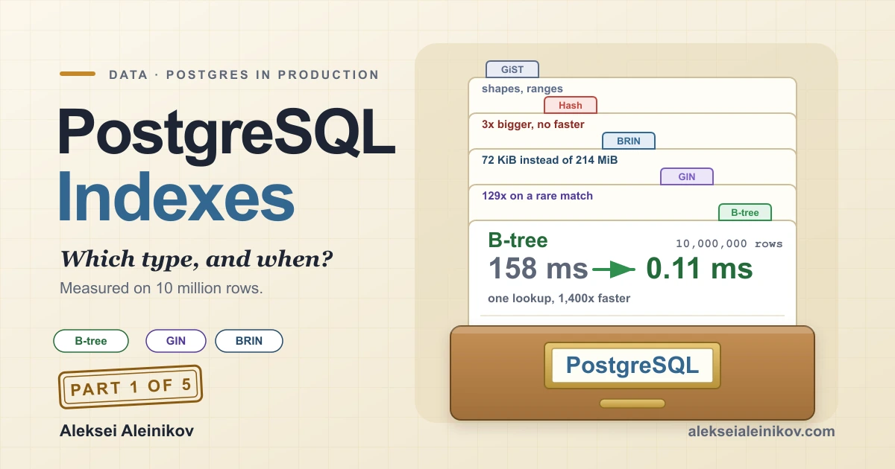

# PostgreSQL Index Benchmark: B-tree vs hash vs BRIN vs GIN on 10 million rows, reproducible

[](LICENSE)
[](https://www.postgresql.org/)

A reproducible benchmark of **PostgreSQL 18 index types** on one table with 10 million rows.
It measures query time, **index size, build time and the cost of every extra index on writes**,
and checks that each index returns exactly the same answer as a plain table scan.

Full write-up with the decision table, the numbers and the explanations:

- English: [PostgreSQL Indexes: Which Type to Use (10M-Row Benchmark)](https://www.alekseialeinikov.com/en/blog/topics/data/postgres-index-types-which-to-use-btree-gin-brin-benchmark)
- Deutsch: [PostgreSQL-Indizes: Welcher Typ wann? (10-Mio-Zeilen-Benchmark)](https://www.alekseialeinikov.com/de/blog/topics/data/postgresql-indizes-welcher-typ-wann-benchmark)



## What it measures

One `events` table (`id`, `user_id`, `status`, `created_at`, `tags text[]`, `payload jsonb`),
generated with a fixed seed, so every run produces the same data.

| ID | Experiment | Index types compared |
|---|---|---|
| A | Point lookup on `user_id` | none, B-tree, hash |
| B | One day out of 10 months | none, B-tree, BRIN (two `pages_per_range` values) |
| C | Newest 50 failed events | none, full `(status, created_at)`, partial `WHERE status = 'failed'` |
| D | Columns served from the index | B-tree, covering `INCLUDE`, with and without a clean visibility map |
| E | Filter on the second column only (PostgreSQL 18 skip scan) | none, multicolumn `(status, created_at)` |
| F | Arrays and `jsonb` containment, parallel GIN build | none, GIN, `jsonb_path_ops` |
| P | Pitfalls: function on the column, low selectivity | B-tree, expression index |
| G | Write cost: insert 1M rows with 0, 1, 3 and 5 secondary indexes | B-tree and GIN |

Nothing is precomputed or stored in this repository: you run it and get the numbers for your own machine.
The published numbers and their analysis are in the article.

Absolute times depend on your machine. Compare the ratios, the index sizes and the plans.

## Reproduce it

Requirements: Node 20 or newer and Docker (about 6 GB of memory for Docker and 10 GB of free disk).
The load takes about a minute, the whole run a few minutes.

```bash
git clone https://github.com/LF3551/postgres-index-benchmark.git
cd postgres-index-benchmark

npm run up       # starts PostgreSQL 18.6 in Docker with the settings from docker-compose.yml
npm run all      # load the data, run every experiment, measure the write cost, print the report
npm run down     # removes the container and its data
```

`npm run all` is the same as running `npm run load`, `npm run bench`, `npm run writes` and `npm run report` one after another.
The report is also saved as `results/report.md`.

### Use your own PostgreSQL

No Docker needed: any PostgreSQL 18 server works. Create an empty database, set the standard `PG*` variables
and the scripts use the local `psql`:

```bash
createdb bench
export PGHOST=localhost PGUSER=postgres PGDATABASE=bench   # plus PGPASSWORD if needed
npm run all
```

Use the settings from [`docker-compose.yml`](docker-compose.yml) for comparable numbers
(`shared_buffers`, `work_mem`, `random_page_cost = 1.1`, `jit = off`, `autovacuum = off`).
On PostgreSQL 17 or older the scripts still run, but skip scan and the `Index Searches` counter are not available.

### Options (environment variables)

| Variable | Default | Meaning |
|---|---|---|
| `ROWS` | `10000000` | Rows in the `events` table (used by `npm run load`). |
| `REPS` | `3` | Timed runs per measurement. One warm-up run is discarded, the median is reported. |
| `ONLY` | all | Comma list of experiments for `npm run bench`, for example `ONLY=B,F`. |
| `COPY_ROWS` | `1000000` | Rows inserted in the write-cost test (`npm run writes`). |

Quick smoke test with a smaller table: `ROWS=1000000 npm run all`.

## How it works

| Step | Detail |
|---|---|
| Data | `generate_series` with `setseed(0.42)`. `created_at` grows with `id`, so it matches the physical order of the table (this is what BRIN needs). `user_id` is random. |
| Statuses | 70% `done`, 20% `active`, 9% `pending`, 0.85% `failed`, 0.15% `archived`. |
| Timing | `EXPLAIN (ANALYZE, BUFFERS)` execution time. Every query runs once as a warm-up, then `REPS` times, and the median is taken. Point and range queries are repeated for several parameter values and the median of those is reported. |
| Answers | Every measured query is also run with index scans disabled. The hash of both answers must match, otherwise the script stops. |
| Sizes | `pg_relation_size` of each index right after the build. |
| Write cost | Insert 1M rows from `events` into an empty table that has a primary key plus 0, 1, 3 or 5 secondary indexes, median of 3 runs. |

## Limitations

- One table, one machine, warm cache. This is a sanity check, not a leaderboard.
- Results depend on data distribution: a hash index or BRIN can win or lose with other data. Change the generator in `scripts/load.mjs` and see.
- `autovacuum = off` keeps the visibility map under the script's control. A production database should not run like that.
